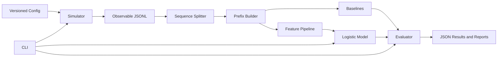
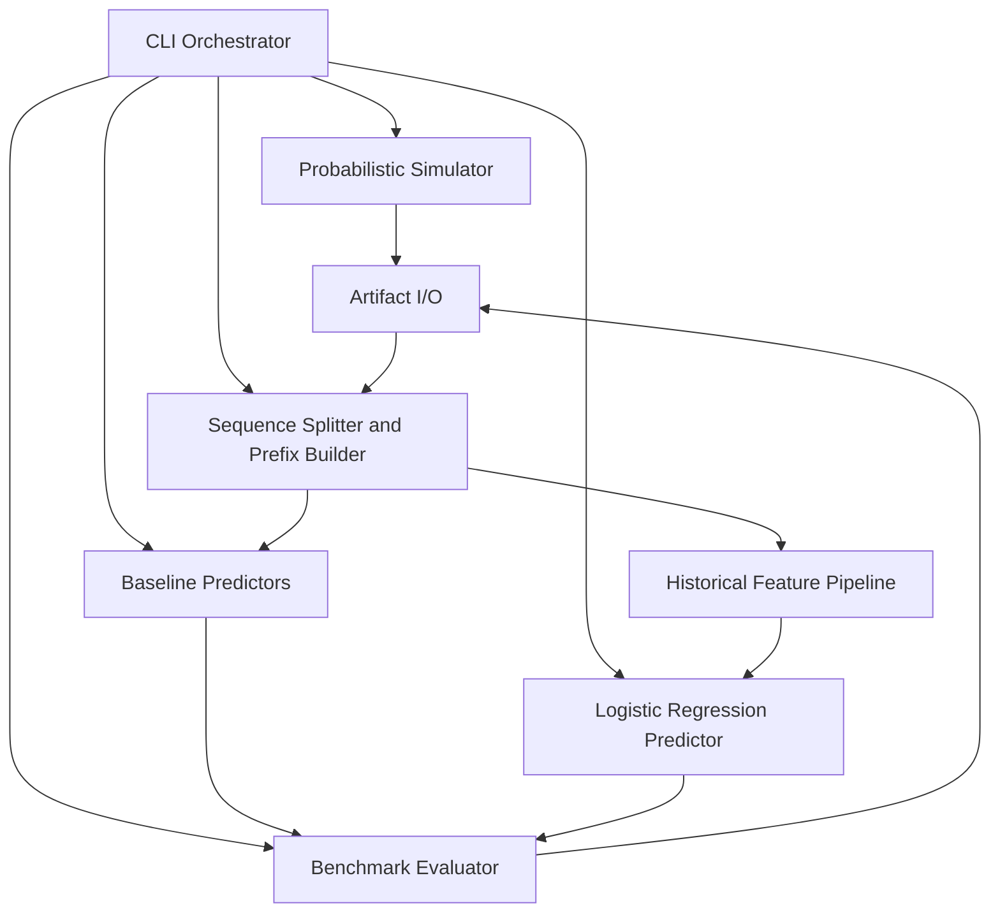
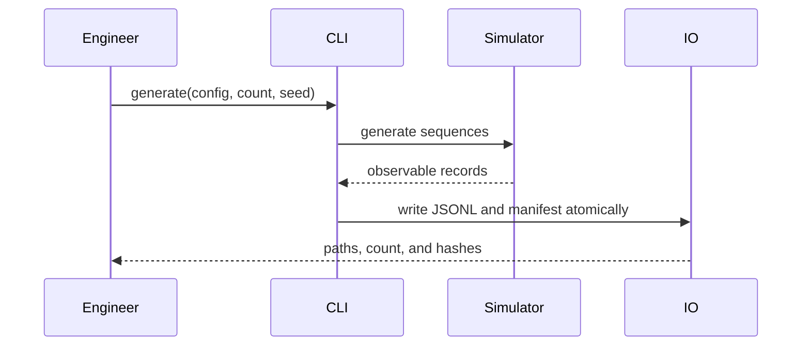
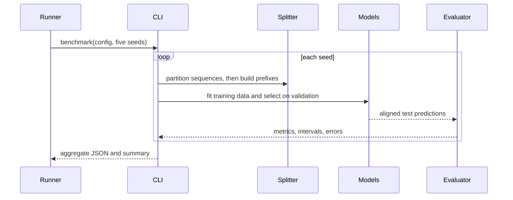
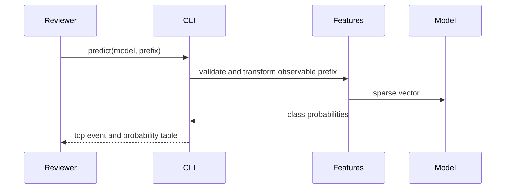

# Technical Design - Software Delivery Event Prediction

Architecture for a CPU-only Python pipeline with explicit simulation, observation, prediction, evaluation, and artifact boundaries.

<!-- toc -->

- [1. Architecture Overview](#1-architecture-overview)
  - [1.1 Architectural Vision](#11-architectural-vision)
  - [1.2 Architecture Drivers](#12-architecture-drivers)
  - [1.3 Architecture Layers](#13-architecture-layers)
- [2. Principles & Constraints](#2-principles--constraints)
  - [2.1 Design Principles](#21-design-principles)
  - [2.2 Constraints](#22-constraints)
- [3. Technical Architecture](#3-technical-architecture)
  - [3.1 Domain Model](#31-domain-model)
  - [3.2 Component Model](#32-component-model)
  - [3.3 API Contracts](#33-api-contracts)
  - [3.4 Internal Dependencies](#34-internal-dependencies)
  - [3.5 External Dependencies](#35-external-dependencies)
  - [3.6 Interactions & Sequences](#36-interactions--sequences)
  - [3.7 Database schemas & tables](#37-database-schemas--tables)
  - [3.8 Deployment Topology](#38-deployment-topology)
- [4. Additional context](#4-additional-context)
- [5. Traceability](#5-traceability)

<!-- /toc -->

- [ ] `p1` - **ID**: `cpt-event-prediction-design-local-pipeline`
## 1. Architecture Overview

### 1.1 Architectural Vision

The system is a local, file-based Python pipeline with explicit boundaries between simulation, observation, feature extraction, prediction, evaluation, and presentation. Every run is driven by versioned configuration and seeds. Dataset and benchmark artifacts are immutable outputs of a run rather than mutable shared state.

The simulator may maintain internal lifecycle context to shape probabilities, but only observable event records cross into the dataset boundary. Complete sequences are partitioned before prefix examples are derived. All models share the same vocabulary, split manifests, and evaluation examples, which makes comparisons paired and auditable.

The design favors a small package, typed internal models, pure transformations where practical, and one CLI surface. It deliberately excludes services, databases, web applications, distributed execution, and neural frameworks.

### 1.2 Architecture Drivers

Requirements that significantly influence architecture decisions.

**ADRs**: `cpt-event-prediction-adr-probabilistic-event-simulator`, `cpt-event-prediction-adr-classical-prediction-models`, `cpt-event-prediction-adr-sequence-level-evaluation`

#### Functional Drivers

| Requirement | Design Response |
|-------------|------------------|
| `cpt-event-prediction-fr-generate-sequences` | A standalone simulator component consumes a versioned transition configuration and random generator. |
| `cpt-event-prediction-fr-history-dependent-transitions` | Base transition weights are adjusted by bounded history and lifecycle-context modifiers before sampling. |
| `cpt-event-prediction-fr-prevent-leakage` | Observation records use an allowlist; splitting precedes prefix construction; feature extraction accepts only prefixes. |
| `cpt-event-prediction-fr-baseline-models` | Baselines implement one prediction protocol and train only on the training partition. |
| `cpt-event-prediction-fr-logistic-regression` | A sparse feature pipeline feeds multinomial logistic regression and persists vocabulary plus model metadata. |
| `cpt-event-prediction-fr-statistical-reporting` | An evaluator aggregates per-sequence predictions, metrics, clustered intervals, paired differences, and errors. |
| `cpt-event-prediction-fr-cli-demo` | One CLI composes generation, benchmarking, and single-prefix inference. |

#### NFR Allocation

| NFR ID | NFR Summary | Allocated To | Design Response | Verification Approach |
|--------|-------------|--------------|-----------------|----------------------|
| `cpt-event-prediction-nfr-reproducibility` | Identical inputs reproduce artifacts | Configuration, simulator, splitter, trainer | Canonical serialization, explicit random generators, persisted seeds and hashes | Golden-hash and repeated-run tests |
| `cpt-event-prediction-nfr-statistical-rigor` | Respect sequence dependence | Splitter and evaluator | Partition and bootstrap at sequence identifier level | Disjointness and clustered-resampling tests |
| `cpt-event-prediction-nfr-local-runtime` | CPU-only within resource target | All components | Sparse features, classical models, streamed JSONL | Timed 10,000-sequence benchmark |
| `cpt-event-prediction-nfr-testability` | Automated critical-path evidence | Component boundaries | Pure functions and injectable random generators | Unit, integration, and CLI tests with coverage report |
| `cpt-event-prediction-nfr-review-usability` | One documented path | CLI and result writer | Stable commands, clear errors, JSON summaries | Clean-environment smoke test |

### 1.3 Architecture Layers

- [ ] `p1` - **ID**: `cpt-event-prediction-tech-python-local`

| Layer | Responsibility | Technology |
|-------|---------------|------------|
| Interface | Parse commands, validate paths and event prefixes, format summaries | Python command-line application |
| Application | Orchestrate generate, train, select, evaluate, and predict workflows | Python service functions |
| Domain | Event vocabulary, transition logic, sequence and prefix invariants, metric records | Typed Python domain objects |
| Infrastructure | JSONL/JSON I/O, sparse feature transformation, model persistence | Python standard library and scikit-learn |

## 2. Principles & Constraints

### 2.1 Design Principles

#### Observable Data Boundary

- [ ] `p1` - **ID**: `cpt-event-prediction-principle-observable-boundary`

All prediction inputs are reconstructed from emitted sequence prefixes. Internal simulator state is never serialized into a field accepted by the feature pipeline.

**ADRs**: `cpt-event-prediction-adr-probabilistic-event-simulator`

#### Baselines Before Complexity

- [ ] `p1` - **ID**: `cpt-event-prediction-principle-baselines-first`

Every learned result is reported beside a global-frequency and smoothed first-order Markov result on identical examples.

**ADRs**: `cpt-event-prediction-adr-classical-prediction-models`

#### Sequence Is the Experimental Unit

- [ ] `p1` - **ID**: `cpt-event-prediction-principle-sequence-unit`

Partitioning, paired comparison, and uncertainty estimation preserve complete sequences as clusters.

**ADRs**: `cpt-event-prediction-adr-sequence-level-evaluation`

#### Immutable Reproducible Artifacts

- [ ] `p2` - **ID**: `cpt-event-prediction-principle-immutable-artifacts`

Generated data, split manifests, model metadata, and benchmark reports record configuration and provenance and are not silently overwritten.

**ADRs**: `cpt-event-prediction-adr-probabilistic-event-simulator`, `cpt-event-prediction-adr-sequence-level-evaluation`

### 2.2 Constraints

#### CPU-Only Local Execution

- [ ] `p1` - **ID**: `cpt-event-prediction-constraint-cpu-local`

The implementation uses Python and scikit-learn on one local process. It introduces no cloud, GPU, service, database, or browser dependency.

**ADRs**: `cpt-event-prediction-adr-classical-prediction-models`

#### Fixed Evaluation Protocol

- [ ] `p1` - **ID**: `cpt-event-prediction-constraint-evaluation-protocol`

Each experiment uses a sequence-level 70/15/15 split, validation-only model selection, a locked test partition, and exactly five declared seeds for the final benchmark.

**ADRs**: `cpt-event-prediction-adr-sequence-level-evaluation`

#### October 24 Delivery Target

- [ ] `p1` - **ID**: `cpt-event-prediction-constraint-schedule`

The architecture must remain implementable, testable, documented, and reviewable by October 24, 2026; optional infrastructure and model families are excluded.

**ADRs**: `cpt-event-prediction-adr-classical-prediction-models`

## 3. Technical Architecture

### 3.1 Domain Model

**Technology**: Typed Python objects and immutable configuration values

**Location**: Implemented domain records in `src/event_prediction/domain.py`, with JSON contracts in `configs/schemas/`

**Core Entities**:

| Entity | Description | Schema |
|--------|-------------|--------|
| EventType | Stable observable code and human-readable description | Defined by versioned event catalog |
| ObservedEvent | Event type and zero-based position within one sequence | JSONL record field |
| EventSequence | Sequence identifier, schema version, observable events, and non-feature provenance | One JSONL line |
| SimulatorContext | In-memory lifecycle flags and counters used only during generation | Never serialized to dataset records |
| PrefixExample | Sequence identifier, observable prefix, and next-event target | Derived after splitting |
| SplitManifest | Seed and disjoint train, validation, and test sequence identifiers | Versioned JSON |
| Prediction | Model identifier, predicted event, class probabilities, and actual event when evaluating | Versioned result record |
| BenchmarkRun | Configuration hashes, versions, seeds, metrics, intervals, comparisons, and artifact paths | Versioned JSON |

**Relationships**:
- EventSequence contains ordered ObservedEvent values from the EventType catalog.
- PrefixExample values are derived from exactly one EventSequence after its split is assigned.
- Prediction values are generated from PrefixExample prefixes and aggregated into BenchmarkRun results.
- SimulatorContext influences sampling but has no relationship to PrefixExample or feature interfaces.

### 3.2 Component Model

#### Probabilistic Simulator

- [ ] `p1` - **ID**: `cpt-event-prediction-component-simulator`

##### Why this component exists

It creates meaningful synthetic delivery histories independently of prediction code.

##### Responsibility scope

Owns the event catalog, transition configuration, bounded history modifiers, internal lifecycle context, seeded sampling, termination policy, and observation projection.

##### Responsibility boundaries

It does not split datasets, construct model features, train predictors, or emit hidden context.

##### Related components (by ID)

- `cpt-event-prediction-component-artifact-io` - receives observable sequence records.
- `cpt-event-prediction-component-splitter` - consumes completed sequence records.

#### Artifact I/O

- [ ] `p1` - **ID**: `cpt-event-prediction-component-artifact-io`

##### Artifact I O purpose

It makes datasets and benchmark evidence portable, versioned, and auditable.

##### Artifact I O responsibility scope

Owns canonical UTF-8 JSONL/JSON serialization, schema-version checks, atomic finalization, hashes, and provenance metadata.

##### Artifact I O responsibility boundaries

It does not infer features or mutate records during reading.

##### Artifact I O relationships by ID

- `cpt-event-prediction-component-simulator` - provides sequence records.
- `cpt-event-prediction-component-evaluator` - provides result records.

#### Sequence Splitter and Prefix Builder

- [ ] `p1` - **ID**: `cpt-event-prediction-component-splitter`

##### Splitter purpose

It enforces the leakage boundary between complete sequences and supervised examples.

##### Splitter responsibility scope

Assigns sequence identifiers to deterministic 70/15/15 partitions and derives prefix-target examples separately within each partition.

##### Splitter responsibility boundaries

It does not inspect target values to stratify or select models and never moves a prefix independently of its source sequence.

##### Splitter relationships by ID

- `cpt-event-prediction-component-feature-pipeline` - receives observable prefixes.
- `cpt-event-prediction-component-baselines` - receives training and evaluation examples.

#### Baseline Predictors

- [ ] `p1` - **ID**: `cpt-event-prediction-component-baselines`

##### Baseline purpose

It establishes performance references with minimal assumptions.

##### Baseline responsibility scope

Fits the global target-frequency distribution and Laplace-smoothed predecessor-successor counts from training examples and exposes a common probability-prediction interface.

##### Baseline responsibility boundaries

It does not consume validation or test targets during fitting.

##### Baseline relationships by ID

- `cpt-event-prediction-component-splitter` - provides examples.
- `cpt-event-prediction-component-evaluator` - consumes predictions.

#### Historical Feature Pipeline

- [ ] `p1` - **ID**: `cpt-event-prediction-component-feature-pipeline`

##### Feature pipeline purpose

It represents observable recency, frequency, order, and recovery context for a linear model.

##### Feature pipeline responsibility scope

Produces sparse features from the prefix: recent event identities, event counts and proportions, observed transition counts, prefix length, failure/fix indicators, and recency since selected events. It learns vocabulary and scaling from training data only.

##### Feature pipeline responsibility boundaries

It rejects fields outside the observable prefix contract and never receives the target or simulator context.

##### Feature pipeline relationships by ID

- `cpt-event-prediction-component-logistic-model` - consumes sparse features.
- `cpt-event-prediction-component-splitter` - supplies prefix-only input.

#### Logistic Regression Predictor

- [ ] `p1` - **ID**: `cpt-event-prediction-component-logistic-model`

##### Logistic model purpose

It learns multiclass next-event probabilities from richer history than the Markov baseline.

##### Logistic model responsibility scope

Fits multinomial logistic regression, selects regularization on validation macro-F1 with a deterministic tie-break, and persists model, label, feature, and provenance metadata.

##### Logistic model responsibility boundaries

It does not select from test metrics and does not generate data.

##### Logistic model relationships by ID

- `cpt-event-prediction-component-feature-pipeline` - transforms prefixes.
- `cpt-event-prediction-component-evaluator` - compares predictions.

#### Benchmark Evaluator

- [ ] `p1` - **ID**: `cpt-event-prediction-component-evaluator`

##### Evaluator purpose

It turns predictions into comparable statistical and diagnostic evidence.

##### Evaluator responsibility scope

Computes accuracy, macro-F1, class support, fixed-order 9x9 confusion matrices, per-seed summaries, mean and sample standard deviation, elementwise-summed aggregate confusion matrices and supports, sequence-clustered bootstrap intervals, paired accuracy and macro-F1 differences, and categorized errors.

##### Evaluator responsibility boundaries

It does not tune models on test results or imply real-world generalization.

##### Evaluator relationships by ID

- `cpt-event-prediction-component-baselines` - provides reference predictions.
- `cpt-event-prediction-component-logistic-model` - provides learned predictions.
- `cpt-event-prediction-component-artifact-io` - writes benchmark artifacts.

#### CLI Orchestrator

- [ ] `p1` - **ID**: `cpt-event-prediction-component-cli`

##### CLI purpose

It provides one reproducible interface for reviewers and automation.

##### CLI responsibility scope

Validates commands and paths, composes workflows, emits concise progress and errors, and returns process exit codes.

##### CLI responsibility boundaries

It contains no transition, feature, model, or metric logic.

##### CLI relationships by ID

- `cpt-event-prediction-component-simulator` - invoked by generation and benchmark workflows.
- `cpt-event-prediction-component-logistic-model` - invoked by training and prediction workflows.
- `cpt-event-prediction-component-evaluator` - invoked by benchmark workflow.

### 3.3 API Contracts

- [ ] `p1` - **ID**: `cpt-event-prediction-interface-cli-design`

- **Contracts**: `cpt-event-prediction-contract-local-files`
- **Technology**: Local command line and versioned files
- **Location**: `README.md`, `src/event_prediction/cli.py`, and `configs/schemas/`

**Commands Overview**:

| Command | Inputs | Outputs | Stability |
|--------|--------|---------|-----------|
| `generate` | Generator config, count, seed, output path | JSONL dataset and manifest | stable |
| `benchmark` | Generator and experiment configs, output directory | Per-seed and aggregate JSON reports | stable |
| `predict` | Model path and event prefix | Predicted event and probabilities | stable |
| `verify` | Project environment | Test and artifact validation status | stable |

### 3.4 Internal Dependencies

| Dependency Module | Interface Used | Purpose |
|-------------------|----------------|----------|
| Domain | Typed values and validation errors | Shared event and artifact invariants |
| Artifact I/O | Reader and writer protocols | Consistent versioning and provenance |
| Prediction protocol | Fit and probability-predict operations | Interchangeable baseline and learned evaluation |

**Dependency Rules**:
- Domain code does not import CLI or infrastructure code.
- Simulator and predictors do not import each other.
- Evaluation depends on prediction protocols, not concrete model internals.
- All randomness enters through explicit seeded random-generator instances.

### 3.5 External Dependencies

#### Python Runtime and scikit-learn

| Dependency Module | Interface Used | Purpose |
|-------------------|---------------|---------|
| Python | Standard library JSON, paths, hashing, argument parsing, and statistics | Runtime and deterministic file workflows |
| NumPy | Explicit random generation, arrays, and bootstrap indexing | Numeric and reproducible sampling operations |
| scikit-learn | Sparse vectorization, multinomial logistic regression, metrics, and model persistence integration | Classical learned model and evaluation primitives |

**Dependency Rules**:
- Exact compatible versions are locked for the submitted environment.
- No dependency makes a network call during generation, training, prediction, or evaluation.
- Serialized models are loaded only from locally produced trusted paths.

### 3.6 Interactions & Sequences

#### Generate Dataset

**ID**: `cpt-event-prediction-seq-generate-dataset`

**Use cases**: `cpt-event-prediction-usecase-generate-dataset`

**Actors**: `cpt-event-prediction-actor-ml-engineer`

**Description**: The CLI validates configuration, the simulator samples sequences with private internal context, and the I/O layer writes only the observable projection plus non-feature provenance.

#### Run Benchmark

**ID**: `cpt-event-prediction-seq-run-benchmark`

**Use cases**: `cpt-event-prediction-usecase-run-benchmark`

**Actors**: `cpt-event-prediction-actor-automation-runner`

**Description**: Every seed runs the same isolated data lifecycle. The evaluator sees aligned model predictions and clusters uncertainty by sequence.

#### Predict from Prefix

**ID**: `cpt-event-prediction-seq-predict-prefix`

**Use cases**: `cpt-event-prediction-usecase-predict-prefix`

**Actors**: `cpt-event-prediction-actor-technical-reviewer`

**Description**: Single-prefix inference uses the same fitted feature pipeline and event catalog as the benchmark and never invokes the simulator.

### 3.7 Database schemas & tables

Database storage is not applicable because all workflows are local, batch-oriented, and reproducible from immutable files. Adding a database would increase setup cost without improving the assignment evidence.

The file boundary is defined by `cpt-event-prediction-interface-artifacts`: JSONL stores ordered sequence records, while JSON stores configuration provenance, split manifests, model metadata, and benchmark results. The implemented machine-readable contracts are in `configs/schemas/` and are enforced by `src/event_prediction/schemas.py` before artifact access or publication.

### 3.8 Deployment Topology

- [ ] `p2` - **ID**: `cpt-event-prediction-topology-local-workstation`

One Python process runs on a reviewer workstation or CI runner. Inputs and outputs remain inside the repository-selected data and results directories. No ports, containers, service accounts, secrets, or external runtime systems are required.

## 4. Additional context

Security, compliance, multi-user authorization, service observability, autoscaling, disaster recovery, frontend architecture, and database operations are not applicable because this is a local synthetic-data experiment with no network surface or personal data. Operational evidence consists of structured logs, exit codes, manifests, hashes, tests, and benchmark result files.

Capacity is bounded by the 10,000-sequence target. JSONL may be streamed, prefix examples may be materialized per split, and sparse matrices are used for learned features. If profiling exceeds the 15-minute or 4 GB targets, the first response is to reduce avoidable materialization, not add distributed infrastructure.

## 5. Traceability

- **PRD**: [PRD.md](./PRD.md)
- **ADRs**: [ADR/](./ADR/)
- **Features**: [features/](./features/)
